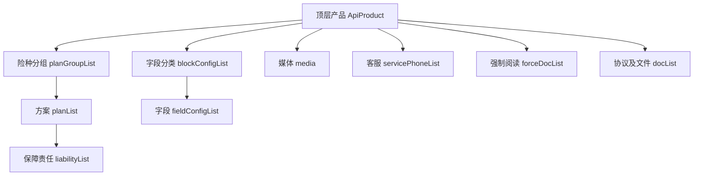

# 接口与数据模型

> 整理日期：2026-10-11。本文根据前端声明整理当前调用约定，没有对后端进行在线验证。未实现的订单、支付、退款能力仅列需求，不虚构接口路径或错误码。

## 一、请求入口与鉴权

### 1.1 小程序请求层

来源：[请求封装](/Users/macbook/Desktop/Insurance/Insurance-Frontend/src/services/api.ts)、[认证](/Users/macbook/Desktop/Insurance/Insurance-Frontend/src/services/auth.ts)、[会话](/Users/macbook/Desktop/Insurance/Insurance-Frontend/src/services/session.ts)。

| 项目 | 当前约定 |
| --- | --- |
| 基础地址 | `https://www.zfxbaoxian.com/prod-api/wxmini`，源码常量 |
| 普通请求 | `Taro.request`，JSON，15秒超时，封装支持 GET/POST/PUT |
| 上传 | `Taro.uploadFile`，字段名 `file`，30秒超时 |
| 响应 | `{ code?: number, msg?: string, data?: T }`，业务码缺失或200视为成功 |
| 令牌字段 | 优先 `apiToken`，兼容字符串及其他 token 字段 |
| 请求头名称 | 读取登录响应的 `header`，默认 `Wx-Authorization` |
| 请求头值 | 默认微信授权头自动补 `Bearer `；其他动态头按服务值传递 |
| 用户标识 | 响应 `userId` 或嵌套用户信息；缺失时从 JWT 载荷提取 |
| HTTP鉴权失效 | HTTP 401/403 清理会话并抛出错误；业务体的非200码只抛出错误 |
| 页面跳转 | 由调用页面处理，统一请求层不自动跳转登录 |

### 1.2 PC 请求层

来源：[统一请求](/Users/macbook/Desktop/Insurance-mana-front/src/utils/request.ts)、[路由守卫](/Users/macbook/Desktop/Insurance-mana-front/src/permission.ts)。

| 项目 | 当前约定 |
| --- | --- |
| 基础前缀 | `import.meta.env.VITE_APP_BASE_API` |
| 开发代理 | Vite 将基础前缀转到 `https://www.zfxbaoxian.com/prod-api` |
| 鉴权 | `Authorization: Bearer <token>`，附带客户端标识及语言头 |
| 超时 | 50秒 |
| 单对象/一般响应 | `{ code, msg, data }` |
| 分页响应 | `{ code, msg, rows, total }` |
| 二进制响应 | `blob` / `arraybuffer` 直接返回内容，二维码另检查文本错误 |
| 重复提交保护 | 同URL、同请求数据在500ms内的POST/PUT会被拦截，可按请求关闭 |
| 可选加密 | 环境启用且请求声明时对POST/PUT加密，响应按加密头解密 |
| FormData | 自动移除 JSON Content-Type，由浏览器生成边界 |
| 会话过期 | 业务401提示重新登录，确认后退出并携带当前路由返回参数 |

不应将 PC 的鉴权头、客户端配置或请求前缀直接套用小程序。两端也不能假定共享同一令牌与用户 ID空间。

## 二、小程序已声明接口

以下均为相对 `/prod-api/wxmini` 的路径。

| 方法 | 路径 | 输入/输出要点 | 调用来源 |
| --- | --- | --- | --- |
| POST | `/login` | 输入 `appid`、`xcxCode`、`clientId`；返回令牌、动态头名称及可能的 `userId` | `services/auth.ts` |
| GET | `/user/phone?phoneCode=...` | 微信手机号动态 code；返回手机号或用户ID，也兼容空 `data` | `services/auth.ts` |
| POST | `/logout` | 退出会话 | `services/auth.ts` |
| GET | `/home/bannerList` | 横幅数组 | `services/home.ts` |
| GET | `/home/companyList` | 合作保险公司数组 | `services/home.ts` |
| GET | `/user/{userId}` | 查询用户资料，缺少ID时前端不请求 | `services/profile.ts` |
| PUT | `/user` | `userId`、`nickName`、`wxAccount`、`sex`、`birth`、`avatar` | `services/profile.ts` |
| POST | `/user/upload` | `file`；输出 `data.url` | `services/profile.ts` |

### 2.1 资料映射

| 服务字段 | 页面字段 | 规则 |
| --- | --- | --- |
| `userId` | `userId` | 转字符串，避免用数值做展示和关联 |
| `nickName` | `nickname` | 保存去首尾空格，页面最多20字 |
| `phonenumber` | `phone` | 手机授权/查询结果，资料保存不提交修改号码 |
| `sex` | `gender` | `0`男、`1`女、其他未知；未知保存为`2` |
| `birth` | `birthday` | 页面取日期前10字符 |
| `avatar` | `avatarUrl` | 上传后取得远程地址 |
| `wxAccount` | `wxAccount` | 代码允许编辑，原型要求只读，待确认 |

### 2.2 首页对象

横幅当前声明 `bannerId`、`bannerUrl`、`linkUrl`、`productId`、`productName`、`sort`、`status`。公司当前声明 `insCompanyId`、`companyName`、`companyNickName`、`companyEngName`、`logoUrl`、`sort`、`status`。

`status='1'` 的数据会被过滤；按 `sort` 升序展示。相对媒体地址转换到业务域名，`//`地址补HTTPS。PC 横幅与公司页面当前没有排序字段维护，是否由后端提供默认排序需确认。

## 三、PC 保险业务接口

### 3.1 产品

来源：[产品服务](/Users/macbook/Desktop/Insurance-mana-front/src/api/product/productManagement/index.ts)。

| 方法 | 路径 | 用途 |
| --- | --- | --- |
| GET | `/product/product/list` | 产品分页、筛选、补取编辑状态 |
| GET | `/product/product/{productId}` | 完整产品详情 |
| PUT | `/product/product/editStatus` | `{ productId, status }` |
| POST | `/product/product` | 服务函数支持基本信息新增 |
| POST | `/product/product/addAll` | 完整配置新增；当前新建页面采用这一流程 |
| PUT | `/product/product` | 基本信息更新 |
| PUT | `/product/product/editAll` | 整份配置更新/临时保存 |
| PUT | `/product/product/{productId}/plan` | 方案分区保存 |
| PUT | `/product/product/{productId}/media` | 介绍媒体分区保存 |
| PUT | `/product/product/{productId}/block` | 投保字段分区保存 |
| PUT | `/product/product/{productId}/forceDoc` | 强制阅读分区保存 |
| PUT | `/product/product/{productId}/doc` | 协议文件分区保存 |
| POST | `/product/product/{productId}/qrcode` | 返回二维码图片Blob |
| GET | `/product/product/productList` | 横幅选择启用产品，位于横幅服务中 |

产品分页输入包括 `pageNum`、`pageSize`、`productCode`、`productName`、`businessDeptId`、`businessDeptName`、`status`。前端映射 `payAmount` 为保费统计、`orderNum` 为订单数。

二维码请求体为：

```json
{
  "productId": "<产品标识>",
  "page": "pages/index/index",
  "params": { "productId": "<产品标识>" },
  "encodeMode": "KV",
  "width": 430
}
```

前端检查空图片与JSON/文本错误，使用临时对象URL预览并释放。二维码如何失效、是否有时限以及微信 `scene` 的实际内容未由本仓库定义。

### 3.2 文档

| 方法 | 路径 | 用途 |
| --- | --- | --- |
| GET | `/product/doc/docList?productId=...` | 读取产品文档；页面保留 `classify` 为2/3的项 |
| GET | `/product/doc/{docId}` | 文档详情 |
| POST | `/product/doc` | 新增文件/协议 |
| PUT | `/product/doc` | 更新文件/协议 |
| DELETE | `/product/doc/{docId}` | 删除文件/协议 |

已有产品的文档弹窗会直接保存服务并回读列表。未保存的新产品先在页面数组中维护，随整份产品提交。

### 3.3 横幅

来源：[横幅服务](/Users/macbook/Desktop/Insurance-mana-front/src/api/product/banner/index.ts)。

| 方法 | 路径 | 用途 |
| --- | --- | --- |
| GET | `/product/banner/list` | `pageNum/pageSize/linkUrl/productId/status`查询 |
| GET | `/product/banner/{bannerId}` | 详情 |
| POST / PUT | `/product/banner` | 新增/更新 |
| DELETE | `/product/banner/{bannerId}` | 删除 |
| PUT | `/product/banner/editStatus` | `{ bannerId, status }` |

页面字段 `image → bannerUrl`、`jumpUrl → linkUrl`；`productId` 和 `status` 保持对应。没有配置产品时不提交产品ID。

### 3.4 合作保险公司与上传

来源：[合作公司服务](/Users/macbook/Desktop/Insurance-mana-front/src/api/product/insuranceCompany/index.ts)、[资源上传](/Users/macbook/Desktop/Insurance-mana-front/src/api/product/uploadImage.ts)。

| 方法 | 路径 | 用途 |
| --- | --- | --- |
| GET | `/product/insCompany/list` | `pageNum/pageSize/companyName/status`查询 |
| GET | `/product/insCompany/companyList` | 配置页选择启用承保公司 |
| GET | `/product/insCompany/{insCompanyId}` | 详情 |
| POST / PUT | `/product/insCompany` | 新增/更新 |
| DELETE | `/product/insCompany/{insCompanyId}` | 删除 |
| PUT | `/product/insCompany/editStatus` | `{ insCompanyId, status }` |
| POST | `/resource/oss/upload` | `FormData.file`，输出 `data.url` |

页面字段映射 `companyId → insCompanyId`、`logo → logoUrl`、`website → linkUrl`，名称和备注同名。

### 3.5 关联框架接口

| 接口或模块 | 在保险业务中的作用 |
| --- | --- |
| `/system/dept/list` | 业务归属来源，仅展示启用部门 |
| `/system/dict/data/type/{dictType}` | 字段及协议类型、校验规则字典 |
| `/system/menu/getRouters` | PC实际菜单及页面组件路径 |
| `/auth/login`、`/auth/logout`、`/system/user/getInfo` | PC认证、用户和权限信息 |
| `/auth/code`、`/auth/tenant/list` | PC图形验证码及租户选择 |
| `src/api/system/user/role/menu/dept` | 人员、角色、菜单和组织通用维护 |
| `src/api/monitor/operlog` | 操作记录 |

产品字典名为 `pro_field_type`、`pro_valid_type`、`pro_busi_valid_type`、`pro_agreement_type`。服务端实际字典值未保存在前端仓库，应读取字典而非硬编码猜测。

## 四、产品数据层级与双向映射

来源：[传输类型](/Users/macbook/Desktop/Insurance-mana-front/src/api/product/productManagement/apiTypes.ts)、[页面类型](/Users/macbook/Desktop/Insurance-mana-front/src/api/product/productManagement/types.ts)、[映射器](/Users/macbook/Desktop/Insurance-mana-front/src/api/product/productManagement/mapper.ts)。



| 服务模型 | 关键字段 | 页面模型映射 |
| --- | --- | --- |
| `ApiProduct` | `productId/productCode/productName/productTitle/businessDeptId/businessDeptName/status` | `productId/code/name/subtitle/businessDeptId/businessUnit/status` |
| `ApiPlanGroup` | `groupId/groupName/classify/insCompanyId/insCompanyName/required/sort` | `ProductItem.apiData/name/type/companyId/companyName/required` |
| `ApiPlan` | `planId/planName/planDesc/price/sort` | `ProductPlan.apiData/name/description/premium` |
| `ApiLiability` | `liabilityId/liabilityName/sumInsured/description/sort` | `ProtectionItem.apiData/name/amount`，责任说明保留在原始模型 |
| `ApiBlockConfig` | `blockId/blockName/blockCode/blockType/fieldConfigList` | `FieldGroup.id/name/fields/apiData` |
| `ApiFieldConfig` | `fieldId/fieldName/fieldLabel/fieldType/fieldPlaceholder/required` | `InsuredField.id/name/type/placeholder/required`；技术字段名仍保留在`apiData` |
| `ApiMedia` | `introInfo/type/videoUrl/picUrl/intervals` | 介绍富文本、视频/轮播类型、地址、间隔 |
| `ApiServicePhone` | `phone/serviceTime/description/visible` | 第一项客服号码、时间、备注；映射器保留其他已有项 |
| `ApiDoc` | `docId/classify/name/contentType/contentText/contentUrl/filePath/version` | 强制阅读或协议文件，按分类转换 |

### 4.1 字段及列表序列化

- 字段类型在 PC 保存为服务端字典值，小程序当前保存中文类型名，必须适配。
- `fieldOptions` 可读取JSON数组、分号、中文分号或换行形式；新增选项通常用中文分号连接。
- `busiValidType` 可读取JSON数组或逗号连接字符串，提交按逗号连接。
- 轮播 `picUrl` 可读取JSON数组或逗号连接字符串，提交按逗号连接。
- 选项/地址内容未变化时，映射器保留原始序列化形式，减少无意义格式变化。
- 分组、方案、责任、字段与文档按 `sort` 排序；保存用页面顺序更新相应序号。

### 4.2 状态与类型编码

| 字段 | 当前前端解释 | 注意 |
| --- | --- | --- |
| 产品/横幅/公司 `status` | `0`启用，`1`停用 | 与 `visible` 编码方向不同 |
| `visible` | `0`不展示，非0视为展示 | 映射器缺失值也会视为展示 |
| `required` | `1`必选/必填，`0`否 | 分组、字段等对象使用 |
| 分组 `classify` | `2`附加险，其余映射主险 | 不代表前端已强制主险数量 |
| 媒体 `type` | `2`轮播，其余映射视频 | 图片URL序列在 `picUrl` |
| 文档 `classify` | `1`强制阅读、`2`协议、`3`产品文件 | 依当前 mapper 解释 |
| 文档 `contentType` | `1`文字、`2`链接、`3`附件 | 协议页面也有专门表单 |
| 强制阅读 `isForceRead` | `0`重要提示；普通文件保存为`1` | 重要提示不执行普通阅读条件 |
| 强制阅读 `readStyle` | `1`滚动到底、`2`时长，可用逗号组合 | PC组合摘要为“并且” |
| 产品 `isEdit` | `0`触发已有订单锁定 | 详情缺失时补查列表，失败则阻止编辑 |

不能统一用一个“0=禁用”的转换函数处理这些字段；编码的上下文不同。

### 4.3 ID、保留字段与复制

`ProductId = string | number`。后续接入应优先将长整数ID作为字符串传递和比较，避免数值精度丢失。页面保留 `apiData`，用于携带服务端ID及页面未编辑的配置字段。

新建和复制提交会清除顶层/子实体ID、关联ID及审计属性；普通更新保留已有ID。`createDept/createBy/createTime/updateBy/updateTime/tenantId/params/isEdit/payAmount/orderNum` 不应作为用户编辑字段回写。

保存之后回读完整配置以取得后端生成的分组/方案/字段ID；如果保存成功但回读失败，页面提示刷新并阻止继续编辑，不能直接重试新增。

### 4.4 当前未完整映射的配置

PC 页面有视频自动播放、静音、视频/封面本地文件名等状态，`toProductRequest` 没有相应持久化字段；封面映射顶层 `logoUrl`。服务模型保留责任 `description`，但配置页面主要编辑责任名称/金额及方案总描述。服务模型含可见、默认、触发字段等信息，页面没有全部编辑能力。

小程序模型则只有标题、副标题、客服电话、产品、表单、文本阅读和单模式规则，缺少PC丰富的文档、媒体、字典、可见性、重要提示及原始接口对象。两端同名类型不能视作已共享契约。

## 五、小程序本地状态与订单示例

来源：[本地产品定义](/Users/macbook/Desktop/Insurance/Insurance-Frontend/src/services/product.ts)。

| 存储键 | 内容 | 当前生命周期 |
| --- | --- | --- |
| `insurance-auth-session` | 令牌、动态头、用户ID、手机号绑定标记 | 登录保存；鉴权失效或退出清理 |
| `insurance-user-profile` | 资料缓存 | 查询/保存更新；退出清理 |
| `insurance-selected-region` | 省市区字符串数组 | 地区选择保存；退出未清理 |
| `insurance-order-draft` | `selectedPlans/totalPremium/formValues` | 方案确认及打开阅读时保存；退出清理 |
| `insurance-orders` | 本地 `OrderRecord[]` | 页面读取；当前流程没有创建新订单的写入；退出清理 |

`SelectedPlanMap` 是险种本地ID到方案ID或`null`的映射。`InsuranceDraft` 的金额只是前端合计。`formValues` 是字段ID到字符串的映射，多选也作为字符串保存。

`OrderRecord` 包括 `id/createdAt/paidAt/status/totalPremium/selectedPlans/formValues`。它没有产品版本、保障快照、支付交易、退款详情或服务端订单权限字段；按当前全局产品配置重建订单内容，不能用于真实历史订单证明。

| 小程序本地状态 | PC示例状态 | 关系 |
| --- | --- | --- |
| 待支付 | `unpaid` | 概念接近，尚无共同服务契约 |
| 已支付，界面显示支付成功 | `paid` | 不能用前端本地值确认收款 |
| 支付失败 | 未独立定义 | 需要后端区分失败、关闭、取消 |
| 退款中 | 未独立定义 | PC示例缺少处理中 |
| 退款完成 | `refunded` | 需要区分退保申请、退款成功和保单终止 |
| 支付结果未知 | 无对应字段 | 小程序结果页临时展示态，不是订单持久状态 |

PC `OrderVO` 使用另一套字段：`orderId/productTitle/businessUnit/productCode/productName/premium/orderNo/merchantOrderNo/paymentNo/studentName/studentIdCard/grade/className/parentName/parentIdCard/phone/totalAmount/createTime/payStatus/payTime`。当前其服务模块没有HTTP请求，数据不会与小程序互通。

## 六、后续必须补齐的服务契约

以下是从原型与当前缺口归纳的能力清单，路径、参数与枚举均待后端确认：

| 能力 | 至少需要确认的契约 |
| --- | --- |
| 产品配置读取 | 产品ID/扫码参数、有效性、版本、适用地区、媒体、分组、字典、文档 |
| 学校与历史被保人 | 学校有效归属、年级班级来源、本人权限与历史信息脱敏 |
| 订单预校验 | 字段校验、必选校验、已支付去重范围、查重失败行为 |
| 下单/恢复订单 | 幂等标识、服务端报价、已选ID、版本、投保快照、阅读及同意记录 |
| 微信支付 | 服务端预支付参数、原生支付调用、回调确认、状态查询、有效时限 |
| 我的订单/PC订单 | 身份及数据范围、筛选、分页、详情、历史快照、不可支付状态 |
| 退款试算与申请 | 可退资格、服务端金额、原因、备注、风险确认、支付原路返回 |
| 退款进度 | 申请/审核/退款状态、金额、时间、原因与交易标识 |
| 统计及导出 | 扣除退款口径、有效订单计数、按产品和权限限定全部匹配记录 |

正式订单应保留产品/方案版本与保障、费用快照，而不是依赖当前产品配置。支付与退款结果由服务端确认；字段及状态一致性必须通过接口评审和联调验证。
