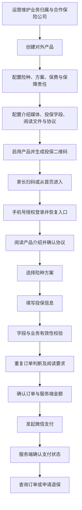

# 正方形保险项目说明

> 整理日期：2026-10-11。依据：两个前端工作区的当前源码、墨刀七个画布、页面批注及嵌入的投保流程需求文档。
> 本说明记录项目目标、设计要求与当前实现；不是后端接口验收报告，也不代表所有页面已经上线。原型中的保险金额、保险条款、客服号码与示例订单不构成正式业务配置。

## 一、快速认识项目

这是面向学生家长的保险服务项目。家长通过微信小程序了解产品、选择保障方案、填写家长与学生信息、阅读投保文件、确认订单，目标是完成微信支付并查询订单和退保进度。运营人员通过 PC 后台配置产品、险种方案、保障责任、投保字段、宣传内容、强制阅读文件、协议、首页横幅与合作保险公司。

项目的核心设计是“管理端配置，小程序按配置展示和收集投保信息”。一个对外投保产品可以包含多个险种分组，每个分组包含多个可选方案，方案包含保费和保障责任。家长选择方案后，形成投保草稿和订单。

### 1.1 两个代码目录

| 端 | 绝对路径 | 技术栈 | 主要职责 |
| --- | --- | --- | --- |
| 微信小程序 | `/Users/macbook/Desktop/Insurance/Insurance-Frontend` | Taro 4.2.1、React 18.3.1、TypeScript、Vite | 登录、首页、个人资料、产品介绍、投保流程、订单及退保页面 |
| PC 管理后台 | `/Users/macbook/Desktop/Insurance-mana-front` | Vue 3.5.30、TypeScript、Element Plus 2.13.5、Pinia、Vite 7.3.2 | 运营配置、产品管理、订单管理、组织与系统权限 |

目录名容易产生误解：`Insurance-Frontend` 实际是小程序，`Insurance-mana-front` 才是 PC 后台。两者是独立 Git 仓库，没有共同的工作区包配置。本次提供的目录不包含后端代码。

### 1.2 当前完成程度

| 功能 | 小程序现状 | PC 现状 |
| --- | --- | --- |
| 登录与退出 | 已编写微信 code 换令牌、绑定手机号、退出接口调用 | 已有框架账号密码、验证码、租户及登录权限流程 |
| 首页横幅、合作公司 | 已编写真实接口调用 | 列表、新增、编辑、状态、删除及资源上传已编写真实接口调用 |
| 个人资料与头像 | 已编写查询、保存、上传接口调用 | 有框架个人中心 |
| 产品与方案配置 | 产品介绍和方案仍是本地固定配置 | 已编写列表、详情、分区保存、复制、二维码及文档接口调用 |
| 投保表单与强制阅读 | 已有页面、校验和阅读交互，数据来自本地配置 | 已有可配置字段、格式/业务规则、富文本及阅读规则 |
| 订单管理 | 读取本地存储，没有服务端订单查询 | 读取 `src/api/order/index.ts` 内存示例数据，没有真实订单接口调用 |
| 支付 | 只有信息展示；确认按钮提示支付暂不可用 | 订单展示不代表具备支付处理能力 |
| 退保、退款进度 | 页面及必填检查存在；提交提示暂不可提交 | 未发现专门退保审核业务页面 |
| 学校选择、历史被保人 | 原型出现，当前未发现完整实现 | 未发现专门学校配置或被保人管理业务页面 |
| 理赔、投诉、常见问题、关于我们 | 建设中提示入口 | 未发现对应保险业务实现 |

“已编写真实接口调用”只表示源码存在服务请求，不表示本次已经验证接口可用、数据正确或生产运行成功。小程序尚未形成真实的下单、支付、退款闭环。

### 1.3 文档阅读入口

| 文档 | 用途 |
| --- | --- |
| [项目说明](./项目说明.md) | 产品定位、跨端流程、模块规则、实现差异与待确认项 |
| [原型与功能索引](./docs/原型与功能索引.md) | 七个原型画布、页面清单、批注来源、视觉与交互结构 |
| [接口与数据模型](./docs/接口与数据模型.md) | 当前接口路径、请求约定、产品层级、字段映射及状态编码 |
| [后续开发指南](./docs/后续开发指南.md) | 启动方式、代码定位、接入顺序与验收场景 |
| [本仓库技术上下文](./AGENT.md) | 当前端的直接依赖、脚本、目录与编码配置 |

项目说明及 `docs` 下三个文档在两个目录中保留同一份内容。后续跨端规则发生变化时，应同步两份；两端的 `AGENT.md` 分别记录各自技术事实。

## 二、信息来源与判定方式

### 2.1 原型来源

原型名称为“正方形-学平险设计”，[原始分享链接](https://modao.cc/proto/Eu5zPbJtjp2lufx3sEcAl/sharing?view_mode=read_only&screen=rbpVTZASrluqBYanq)。本次读取了七个画布的页面内容和可见批注。画布目录及入口详见原型索引。

“产品管理 -最新版本”画布内的 `index` 页面含《方案详情01投保流程产品需求文档》，标注版本 V1.0、日期 2026-08-31、目标地区河北省保定市竞秀区。其他批注包括 2026-09-04 的销售流程、2026-09-07 的产品配置规则、2026-09-08 的退款校验，以及 2026-10-08 的新版手机号授权登录。

“销售端登录、首页、我的”中的旧微信登录页明确标记“弃用”；“登录界面”中的验证码登录和账号登录明确标记“二期”。这些标签属于小程序原型，不能据此认定 PC 后台登录需要替换为微信授权。

### 2.2 本文标记

- **代码现状**：可以从当前工作区源码直接确认的行为。
- **原型要求**：原型页面、批注或嵌入需求文档中的目标行为。
- **待确认**：材料之间冲突、规则不完整或缺少后端契约的内容。
- **开发建议**：根据现状提出的后续实施方向，不代表已经批准的功能规格。

原型、批注与源码存在差异时，本文并列记录，不把某一份材料自动提升为最终业务规则。正式保险责任、费率、保障期间、退保条件及协议应以业务方确认的材料与服务端配置为准。

### 2.3 代码基线

| 仓库 | 整理开始时最新提交 |
| --- | --- |
| 小程序 | `01a8125b60637263b29c1b6db5355da352721431` |
| PC | `dab5f78f8a9ffb79eb6f4969988d32e192fd7c8f` |

PC 工作区在整理前已有产品、横幅、保险公司、上传、配置组件、Vite 及测试相关未提交改动。本文依据的是包含这些改动的工作区，不只依据上述提交。源码变化后需要重新核对本文。

## 三、用户、术语与业务对象

### 3.1 主要用户

| 用户 | 目标 | 当前证据边界 |
| --- | --- | --- |
| 学生家长、投保人 | 为学生购买保障、查询订单、申请退保 | 小程序是主要使用端 |
| 学生、被保险人 | 作为投保信息中的保障对象 | 没有独立学生登录端 |
| 运营人员 | 配置产品及首页内容、查看订单和统计 | PC 自定义保险业务模块 |
| 机构、部门负责人 | 管理业务归属、人员及数据范围 | 框架部门、用户、角色功能；具体权限矩阵待确认 |
| 系统管理员 | 管理菜单、角色、字典及基础配置 | 框架能力，实际可见菜单由后端返回 |

原型中的超级管理员、部门经理、运营、财务、销售等角色是设计示例。当前前端没有一份完整且固定的保险业务角色权限矩阵。

### 3.2 术语对照

| 术语 | 含义 | 代码对象 |
| --- | --- | --- |
| 对外产品、投保活动 | 一份可生成二维码、供家长进入的产品配置 | PC `ApiProduct` / `ProductConfig` |
| 险种、产品分组 | 对外产品内的学平险、监护人责任险等分组 | PC `ApiPlanGroup`；两端页面模型 `ProductItem` |
| 方案、保障计划 | 某个险种下的无忧版、普惠版等选项 | `ApiPlan` / `ProductPlan` |
| 保障责任 | 保障项目及金额、说明 | `ApiLiability` / `ProtectionItem` |
| 投保字段分类 | 家长信息、学生信息等表单分组 | `ApiBlockConfig` / `FieldGroup` |
| 投保字段 | 姓名、证件类型、证件号、年级等 | `ApiFieldConfig` / `InsuredField` |
| 强制阅读文件 | 提交投保前按条件逐份阅读的文件 | `ApiDoc` / `ForceReadItem` |
| 产品文件、协议配置 | 文字、链接、附件及带版本的协议 | PC `AgreementConfigItem` |
| 业务归属 | 运营产品所属机构或部门 | `businessDeptId`、`businessDeptName` |
| 投保草稿 | 已选方案、表单输入及展示金额 | 小程序 `InsuranceDraft` |
| 订单 | 服务端目标业务记录；当前两端仍有本地模型 | 小程序 `OrderRecord`；PC `OrderVO` |

最容易混淆的是“产品”：PC 列表的一条记录是顶层产品，配置页中的“添加产品”添加的是其内部险种分组；不能把两者的 ID、保存接口和生命周期混用。

## 四、跨端业务流程

### 4.1 目标配置与销售流程

这是目标关系图。学校选择的位置、重复订单判断与强制阅读的准确先后，应结合下文冲突项确认。目前小程序产品配置、真实订单与支付服务尚未连通。

### 4.2 当前小程序导航链

`login → home / mine → index（产品介绍）→ plan → insure → order-confirm → payment`

订单及售后链为：`orders → order-detail → payment / refund-apply / refund-status`。`pay-result` 与 `qr-expired` 页面已注册，但尚未建立完整服务端结果与扫码失效判定链。

首页会将 `productId` 传到介绍页，PC 二维码也会携带该参数，但介绍页与方案服务未使用该 ID 加载配置。当前不同产品入口仍可能展示同一套本地示例内容。

## 五、小程序功能与交互

### 5.1 登录、登录态与入口恢复

**原型要求**：新版使用手机号一键登录。允许授权后进入首页；如果从二维码进入，应回到原投保页面。拒绝授权要给出可理解的提示。验证码和账号登录是二期。

**代码现状**：

- 默认启动页面为 `pages/login/index`。已存在会话时直接进入首页。
- 用户先勾选用户协议与隐私政策，再调用微信手机号授权按钮。
- `Taro.login()` 获取微信 code；业务 `/login` 换令牌；`/user/phone` 绑定手机号。
- 防止重复登录，支持授权拒绝、异常及加载状态。手机号绑定失败会清理会话。
- 登录响应缺少用户 ID 时，从服务端令牌的 JWT 载荷读取 `userId`。这只是提取用户标识，不能代替服务端验签和权限校验。
- 登录完成固定 `reLaunch` 首页，尚未恢复扫码入口或原产品上下文。
- 登录协议为本地提示文本，尚未接入正式协议。

代码位置：[登录页面](/Users/macbook/Desktop/Insurance/Insurance-Frontend/src/pages/login/index.tsx)、[认证服务](/Users/macbook/Desktop/Insurance/Insurance-Frontend/src/services/auth.ts)、[会话服务](/Users/macbook/Desktop/Insurance/Insurance-Frontend/src/services/session.ts)。

### 5.2 首页、地区与推荐内容

**原型结构**：地区栏、首页横幅、订单/保单等快捷入口、热门产品、合作保险公司、首页/我的底部导航。批注将热门产品描述为展位占位，理赔与常见问题在当前阶段显示建设中。

**代码现状**：

- 横幅和保险公司并行请求；过滤停用状态并按 `sort` 排序。请求失败有错误提示和重新加载入口。
- 横幅无数据时显示本地备用图。热门产品从横幅关联的产品去重生成，没有独立热门产品接口。
- 横幅点击只使用 `productId`；只配置 `linkUrl` 时尚不能按链接跳转。
- 合作公司展示 Logo 和名称，支持横向查看；未实现其官网跳转。
- 地区是微信原生省市区选择器，默认河北省保定市竞秀区，选择结果缓存在本地；没有自动定位或地区驱动产品过滤请求。
- 底部导航是自定义组件，通过 `redirectTo` 切换首页与我的，没有使用原生 `tabBar`。

代码位置：[首页](/Users/macbook/Desktop/Insurance/Insurance-Frontend/src/pages/home/index.tsx)、[首页服务](/Users/macbook/Desktop/Insurance/Insurance-Frontend/src/services/home.ts)、[地区栏](/Users/macbook/Desktop/Insurance/Insurance-Frontend/src/components/location-header/index.tsx)。

### 5.3 我的、个人信息与头像

我的页提供订单、头像、个人信息与帮助入口。理赔报案、投诉建议、常见问题、关于我们为建设中提示；客服电话入口提示配置中。退出前弹窗确认，之后调用退出服务并清理会话、个人资料、投保草稿和本地订单缓存。

个人信息包括头像、昵称、手机号、性别、生日、微信号。昵称最多 20 字；性别为男、女、未知；手机号只读。头像支持拍照或相册选择，上传成功后保存资料并返回。缺少 `userId` 时，资料读取和保存会被阻止并提示原因。

**差异**：原型批注只允许编辑昵称、性别、生日；当前代码还允许编辑微信号。个人资料手机号当前直接显示接口返回值，原型显示为脱敏号码。

代码位置：[个人信息](/Users/macbook/Desktop/Insurance/Insurance-Frontend/src/pages/profile/index.tsx)、[头像页面](/Users/macbook/Desktop/Insurance/Insurance-Frontend/src/pages/avatar/index.tsx)、[资料服务](/Users/macbook/Desktop/Insurance/Insurance-Frontend/src/services/profile.ts)。

### 5.4 产品介绍

**原型要求**：展示固定地区、致家长的一封信、宣传视频或图片轮播、客服及服务时间、多份协议和底部“开始投保”。协议默认为未勾选，打开协议内容不能自动勾选；返回页面需要重新确认。后台配置协议优先，缺失时原型允许默认协议。

**代码现状**：介绍内容在 `pages/index/index.tsx` 的 `pageConfig` 中写死。支持视频、图片轮播、媒体占位与播放错误，当前视频地址为空。支持客服电话格式检查、协议滚动弹窗，`useDidShow` 重置勾选状态；未同意时按钮禁用，同意后进入方案页。

**待接入**：产品 ID、远程介绍配置、正式富文本、媒体和协议；原型嵌入需求文档中的学校选择器目前不存在。顶部地区不是与首页地区缓存共用的数据源。

### 5.5 方案选择与缴费明细

**原型要求**：按配置顺序展示险种编号和名称；每个险种展示方案标签、保障项目与金额、承保公司和详情。超过两个方案时显示更多入口。取消某个可选险种后，其保费为零，隐藏对应责任、详情及承保区域。切换方案应联动更新展示与合计，金额展示两位小数。

**代码现状**：使用 `services/product.ts` 的固定 `productConfig`。已支持方案切换、更多方案操作菜单、可选分组“不选”、保障详情、投保须知及缴费明细浮层。默认所有分组都选第一个方案，包含可选附加险。合计由前端 `calculatePremium` 求和。

选择约束当前依赖 `required`，不单独依赖“主险/附加险”类型。必选分组未选时阻止进入投保。提示确认后保存草稿；方案与上次相同才保留旧表单数据，否则清空表单。

**差异**：可选险种取消后，代码仍显示标题中的承保公司；原型要求该区域隐藏。当前金额是展示用本地计算值，未来真实支付金额必须由服务端确认。

代码位置：[方案页面](/Users/macbook/Desktop/Insurance/Insurance-Frontend/src/pages/plan/index.tsx)、[本地产品模型](/Users/macbook/Desktop/Insurance/Insurance-Frontend/src/services/product.ts)。

### 5.6 投保表单、字段校验与重复订单

表单按字段分类渲染，支持文本、日期、单选、多选、身份证、手机六类。当前示例包含家长姓名、证件类型、证件号、联系电话，学生姓名、证件类型、证件号、学校、年级、班级，以及可选生日与兴趣爱好。

**代码校验**：先检查必填；居民身份证使用 `17 位数字 + 数字或 X` 的格式检查；其他证件为 5～20 位字母数字；手机为以 1 开头的 11 位数字。字段下面显示错误，并提示首个错误。没有身份证真实性、校验码核验或定位滚动到首个错误字段。

当前重复订单判定只检查本地 `insurance-orders` 中相同学生证件号码且状态为“已支付”的记录。命中后弹窗取消留在表单，确认继续强制阅读及确认订单。没有服务端去重、年度/方案范围、竞态复核或请求幂等。

**原型要求**：表单及校验来自管理端配置；有历史被保人入口；重复已支付订单由服务端判定；查询失败不能当成无重复；确认继续时再次验证是否允许支付。去重范围和“继续支付”的具体含义仍需业务确认。

代码位置：[投保页](/Users/macbook/Desktop/Insurance/Insurance-Frontend/src/pages/insure/index.tsx)。

### 5.7 强制阅读

**原型要求**：用户提交有效投保信息后按配置顺序阅读多份文件，完成每份的滚动到底或规定时长，才能点击下一步；全部完成后继续投保。管理端配置阅读内容及统一规则，重要提示有单独展示方式。

**代码现状**：投保页有阅读弹窗、文件序号、倒计时、滚动到底判定及下一步禁用状态。小程序模型只有 `mode: scroll | timer`，一次只能执行一种规则；内容是文本段落数组，没有重要提示、启停或正式协议版本阅读记录。草稿在打开阅读时写入本地，读完跳到确认订单。

**跨端差异**：PC 可以同时要求滑到底部与阅读时长，界面摘要用“并且”；小程序无法表达这个组合。PC 文件内容是富文本字符串，类型及字段也与小程序不同。接入时需要明确转换模型，不能直接复制对象。

### 5.8 确认订单与支付

确认页展示已选方案、保费、承保公司、缴费方式、投保字段和两种明细浮层。证件号和电话在确认及订单详情页做遮罩显示。保障期间当前显示“以正式保单为准”。

**代码现状**：确认页只是读取草稿；点击立即支付跳到支付页面，没有创建服务端订单。支付页面读取草稿或指定本地订单，只有待支付/支付失败状态允许继续展示支付；点击确认支付提示“支付暂不可用”。未发现 `Taro.requestPayment`、服务端预支付或回调结果查询调用。

支付结果页根据本地订单映射成功、失败、未知。未知状态显示待确认提示，但不会向服务端查询。当前用户流程也没有写入新订单到 `insurance-orders` 的代码，因而新用户通常看不到由真实投保生成的订单。

**原型要求**：服务端创建/确认订单并返回金额；支付中防重复；取消不标成已支付；成功以服务端结果为准；未知时查询最终状态。批注还写有订单创建 24 小时未支付转支付失败、支付页停留超过 2 小时提示订单关闭，这两个时限需要后端规则确认。

### 5.9 订单、退保与二维码失效

订单列表支持订单号/学生姓名搜索，以及全部、待支付、支付成功、支付失败、退款中、退款完成筛选。详情展示方案、责任、投保信息和订单字段，并按状态提供继续支付、申请退保或退款进度入口。

退保页默认不选原因、不确认风险；必须选择原因和勾选风险确认，备注最多 200 字，退款方式展示原路返回。当前可退金额为待核算，提交提示不可提交，不会产生退款记录。退款进度页只读取本地退款状态。

原型另有可退金额详情、提交成功提示、处理中和已完成信息、申请时间、退款原因、支付交易号及预计到账提示。这些服务字段及金额算法尚未在当前代码中落实，不能固定承诺全额退或 1～3 个工作日到账。

二维码失效页已存在，展示原因和返回首页；目前没有二维码参数解析、产品失效校验或自动跳转该页的流程。

## 六、PC 管理后台功能

### 6.1 产品列表

默认展示启用产品，可切换禁用。支持产品编码、名称、业务归属筛选，展示创建时间、保费统计、订单数量和行操作：编辑、复制、二维码、订单、启用/禁用。

产品列表已使用 `/product/product/list`，业务归属来自启用部门。列表保费和订单数量直接映射服务端 `payAmount`、`orderNum`，前端不重新计算统计。

**原型统计口径**：保费统计为已支付保费扣除退款；订单数量为支付完成订单扣除退单，不计未支付。统计点击应带相应筛选，导出按筛选范围，无筛选默认全部导出。

**差异**：当前 `showOrders` 忽略行产品，只在点击保费时传 `payStatus=paid`；没有携带产品 ID/编码，也没有对订单数量传入同样的有效订单条件。订单页面仍是示例数据，尚未与列表真实统计闭环。

### 6.2 产品配置六个分区

| 分区 | 主要内容 | 规则与现状 |
| --- | --- | --- |
| 基本信息 | 产品名称、产品编码、业务归属 | 三项必填；归属对应部门 ID |
| 产品方案配置 | 页面副标题、内部险种、类型、公司、必选、方案、保费、保障责任、富文本详情 | 可添加/删除分组及方案，保费输入最小为 0；没有强制只有一个主险的校验 |
| 介绍页配置 | 顶部富文本、视频/图片轮播、封面、播放选项、客服 | 视频与轮播切换、媒体上传、图片排序；部分播放字段尚未映射到接口 |
| 投保信息配置 | 分类、字段、类型、占位、选项、格式与业务规则、必填、排序 | 类型与规则从服务字典获取；编辑后排序归一 |
| 强制阅读 | 重要提示、其他阅读文件、启停、顺序、富文本、统一规则 | 至少选择滚动或时长之一；可以同时选择；重要提示不参与普通强制阅读规则 |
| 协议文件配置 | 产品文件、协议类型、标题、版本、文字/链接/附件、启停、排序 | 已有产品的文件可单独增改删并回读；新产品先暂存在页面配置中 |

主要代码：[产品配置页面](/Users/macbook/Desktop/Insurance-mana-front/src/views/product/productManagement/config.vue)、[介绍配置组件](/Users/macbook/Desktop/Insurance-mana-front/src/views/product/productManagement/components/IntroductionConfig.vue)、[字段配置组件](/Users/macbook/Desktop/Insurance-mana-front/src/views/product/productManagement/components/InsuredFieldsConfig.vue)。

### 6.3 保存、复制与有订单后的限制

临时保存提交整份配置，当前仍要求完整基本信息，不是无条件保存任意空稿。新产品由页面整份新增，并要求接口返回产品 ID。已有产品普通保存按当前页签调用对应分区接口，保存后回读服务端生成的子对象 ID，避免后续重复新增。

复制进入新建模式，清空顶层 ID、编码与业务归属，并清除新提交模型中的嵌套主键、审计字段和订单统计。复制不等于修改原产品。

已产生订单时，由 `isEdit` 和 `orderNum` 判定 `hasOrders`。详情缺少编辑状态时，会补查产品列表；仍无法确认则停止编辑。当前前端限制如下：

| 配置内容 | 已有订单时 |
| --- | --- |
| 产品名称、编码、业务归属 | 锁定 |
| 险种名称、类型、公司、必选，方案名称、保费及增删结构 | 锁定 |
| 页面展示、副标题、保障责任、方案详情 | 可编辑 |
| 介绍页、客服、强制阅读、协议文件 | 可编辑 |
| 投保字段分类及字段 | 锁定 |

上述限制与 2026-09-07 批注中的可修改范围基本对应。前端锁定不能替代后端限制；订单详情还需要方案版本或快照，避免后来修改责任导致历史订单变化。

### 6.4 字段配置与文件上传

字段分类支持重命名、上移、下移、删除；字段支持增删、排序、必填和选项设置。选项去除空项后至少一项，不允许重复，也不能包含分号或换行。格式规则为单选，业务规则为多选，“无”与其他业务规则互斥。

| 资源 | 当前代码限制 |
| --- | --- |
| 首页横幅、合作公司 Logo | JPG/PNG，不超过 2MB |
| 介绍页轮播、封面图 | JPG/PNG/WebP，不超过 5MB |
| 介绍页视频 | MP4/MOV/WebM，不超过 100MB |
| 协议附件 | PDF、DOC、DOCX、JPG、JPEG、PNG，不超过 20MB |

资源上传使用 `/resource/oss/upload`，接受服务端远程地址，拒绝将 `blob:` 或 `data:` 地址作为有效上传结果。图片、视频和协议上传的文件限制来自当前代码，不是原型已确认的统一资源规范。

### 6.5 首页横幅与合作保险公司

横幅列表支持跳转地址、关联产品、状态筛选。图片必填；链接及关联产品选填，产品下拉只显示启用产品。原型明确“关联产品与跳转页面同时存在时，以产品为主”；小程序还缺少仅链接时的跳转逻辑。

合作公司支持名称和状态查询、Logo、名称、官网地址、备注、启停、编辑与删除。当前名称必填，官网选填且只接受 HTTP/HTTPS；名称最长 50 字，备注最长 200 字。启用公司不能删除，需先停用。**差异**：原型规定 Logo 必填，但当前规则没有实际阻止空 Logo 保存。

### 6.6 订单与导出

订单页面展示总订单、已支付、未支付、已支付保费四项统计，支持关键词、状态、创建日期、产品编码过滤，分页与详情抽屉。统计卡可以切换支付状态筛选；详情和导出包含学生、家长、证件及联系字段。

当前全部订单来自 `src/api/order/index.ts` 中固定数组，异步延迟只是模拟服务。导出使用 `listAllOrders(query)` 获得全部匹配示例记录，在浏览器生成带中文表头的 CSV，不是服务端导出，也不是 XLSX。

后续真实接入需要按当前用户权限限制数据及导出范围，统一退款后的统计口径；当前模板列表/详情/CSV存在完整证件与电话展示，与原型需求文档中的脱敏目标不同。

### 6.7 组织、权限与框架模块

PC 继承 RuoYi-Vue-Plus 管理框架，已有部门、用户、岗位、角色、菜单、个人中心、字典、参数、通知、OSS、租户/套餐、日志、在线用户，以及工作流、代码生成、监控和示例模块。

这些源码目录的存在不等于保险项目本期全部启用；可见菜单依赖 `/system/menu/getRouters` 与角色权限。部门映射业务归属；用户和岗位可承载员工管理；角色控制菜单及数据范围。没有发现原型“公司管理”对应的独立保险公司组织页面，不能直接把框架租户管理当作其已经完成的实现。

PC 修改密码位于个人中心组件，代码为 6～20 字符并禁止部分非法字符；原型要求至少 8 位且包含字母数字，规则存在差异。框架系统页普遍使用 `v-hasPermi`；自定义保险页尚未普遍使用同样的按钮权限声明，具体权限需要后端及菜单配置落实。

## 七、设计与工程架构

### 7.1 小程序

- 页面采用 React 函数组件与 Hooks，Taro 组件渲染；没有第三方 UI 组件库或独立全局状态库。
- `src/pages` 放页面，`src/components` 放地区栏和底部导航，`src/services` 放请求、会话、资料、首页和本地产品模型。
- 页面注册集中于 `src/app.config.ts`。构建设计宽度为 750，由 Taro 转换尺寸；不能把源码 CSS 的 32px 直接理解为真机 32px。
- 首页/我的/登录/介绍页有自定义导航；其他业务页使用小程序原生导航标题。顶部考虑系统状态栏与胶囊区域，底部考虑安全区。
- 草稿和本地订单使用同步存储，不按产品或年度分桶；资料缓存与地区缓存是独立键。

### 7.2 PC 管理后台

- Vue 单文件组件，Composition API、`script setup`、TypeScript；页面样式主要使用 scoped SCSS，另有全局框架样式和 UnoCSS。
- `src/api` 管理接口与类型，`src/views` 管理页面，`src/utils/request.ts` 是统一 Axios 请求层。
- 产品服务分成 `apiTypes.ts`（传输模型）、`types.ts`（页面模型）、`mapper.ts`（双向映射），不要把接口字段映射分散到页面。
- Pinia 管理登录用户、权限菜单和框架状态。固定路由与服务端动态菜单共同组成导航。
- 后端可能仍引用 `product/product/index`、`product/insCompany/index`，两个兼容组件分别转到当前真实页面，应保持兼容关系。
- 当前采用 `createWebHistory`，部署需要服务器支持前端路由回退。

### 7.3 跨端边界

两端没有共享模型包，虽然都叫 `ProductConfig`、`ProductItem`，并非相同类型。PC 模型已围绕后端嵌套接口建设；小程序仍用中文类型名、本地字符串 ID和固定示例字段 ID。接入小程序时需定义清晰的传输模型与适配层，按服务端 ID处理分组、方案和字段，保持长 ID精度。

服务端应负责产品有效性、最终金额、订单去重、支付许可、状态变更、退款金额及数据权限。页面中的显示金额、按钮禁用和本地状态不能承担这些最终判断。

## 八、关键差异与待确认事项

以下编号由本文为追踪生成，不是墨刀原生需求编号，也不是已冻结的实施规格。

| 编号 | 问题 | 原型/需求 | 当前实现或缺口 | 下一步 |
| --- | --- | --- | --- | --- |
| 差异-01 | 产品配置未跨端打通 | 后台配置驱动小程序 | 介绍和方案分别写死 | 确认小程序配置接口与映射 |
| 差异-02 | 扫码上下文 | 登录后回到扫码页面 | 固定进入首页，未解析 `scene` | 保存并恢复入口，校验失效 |
| 差异-03 | 学校选择 | 嵌入需求文档要求先选学校 | 表单只有学校文本字段 | 确认学校列表来源、选择时点与归属 |
| 差异-04 | 定位与地区 | 首页自动定位失败再手选；投保地区只读 | 首页只有手选，介绍页固定地区 | 区分服务地区与产品绑定地区 |
| 差异-05 | 主险与必选 | 早期主险必选，后期按必选开关 | 小程序按 `required`，后台未限制主险数量 | 确认最终规则及默认选中方式 |
| 差异-06 | 强制阅读组合 | 原型部分画面二选一；PC支持组合 | 小程序仅滚动/时长二选一 | 确认规则含义，统一富文本与记录 |
| 差异-07 | 重复投保 | 同一学生存在已支付订单提示 | 仅本地查重，确认继续确认流程 | 定义年度/产品范围及服务端分支 |
| 差异-08 | 订单闭环 | 创建订单、支付查询、恢复 | 两端示例数据，小程序没有创建订单 | 定义订单服务与快照 |
| 差异-09 | 支付时限 | 24小时未支付失败，支付页2小时关闭 | 未实现超时判定与服务端状态 | 统一失效时限和重新支付方式 |
| 差异-10 | 退款资格及金额 | 生效后不可退的示例文本与退保页面并存 | 无退款服务，金额待核算 | 确认资格、金额、审批与到账规则 |
| 差异-11 | 统计与订单范围 | 点击当前产品统计并对应筛选 | 跳转丢失当前产品 | 携带产品标识，接真实统计 |
| 差异-12 | 协议正式内容 | 管理端配置，可有默认内容 | 登录/介绍/须知仍有本地简化文本 | 确认正式版本及同意记录 |
| 差异-13 | 微信号编辑 | 原型不可编辑 | 小程序允许编辑 | 确认个人资料边界 |
| 差异-14 | Logo必填 | 原型要求必填 | PC没有对应必填规则 | 对齐业务校验 |
| 差异-15 | 横幅链接与公司跳转 | 原型配置跳转地址 | 小程序没有链接回退及公司跳转 | 确认小程序合法承载方式 |
| 差异-16 | 热门产品 | 原型批注为占位 | 按横幅产品生成推荐列表 | 确认当前阶段是否接受该行为 |
| 差异-17 | 媒体持久化 | 运营配置视频展示 | 自动播放、静音与本地文件名未完整映射 | 明确服务端字段支持 |
| 差异-18 | 历史被保人 | 表单原型有入口 | 未实现 | 确认身份归属及数据源 |
| 差异-19 | 隐私展示 | 需求文档要求回显脱敏 | PC订单及个人资料部分仍明文 | 按场景落实权限与遮罩 |
| 差异-20 | 组织与权限 | 公司、部门、员工及角色设计 | 部分沿用框架，保险按钮权限未完整声明 | 确认菜单、角色和数据范围 |
| 差异-21 | 密码规则 | 至少8位且字母数字 | 框架6～20字符 | 确认PC最终账号安全规则 |

此外还需确认保障期间、是否按学校/年度创建独立产品、方案下线后如何处理草稿、未支付订单能否复用、产品修改是否有发布机制、服务字段字典值、支付凭证/电子保单是否提供。当前服务声明没有完整产品版本、发布状态或保险保单模型，不能凭页面名称自行补造。

## 九、建议的后续建设顺序

1. **产品配置闭环**：确定小程序配置读取接口，打通产品 ID/扫码入口、远程介绍、方案、字段、媒体与协议；在后端判定产品是否可投保。
2. **规则统一**：确认学校、必选、证件、去重、强制阅读、协议版本与有订单后的修改边界，使两端映射一致。
3. **订单闭环**：服务端金额、创建/恢复订单、幂等、历史方案快照和权限范围；替换两端订单示例数据。
4. **支付闭环**：预支付、微信原生支付、取消/失败/未知结果查询、超时和服务端回调；不能在前端手工标记支付成功。
5. **退保闭环**：退款资格、服务端试算、原因与确认记录、提交、审核/退款状态及到账信息。
6. **运营完善**：真实统计和导出、链接承载、正式协议、组织权限及后续理赔帮助模块。

详细代码入口、命令与验收清单见[后续开发指南](./docs/后续开发指南.md)。

## 十、说明的验证范围

本次完成代码结构、页面注册、核心实现、接口声明及原型七个画布的交叉阅读，并校验文档链接、页面数量及文件写入范围。没有修改业务源码，没有实际登录、提交订单、支付、退款、变更后台配置或使用生产个人数据测试。运行时、接口可用性和保险业务最终规则仍需在后续联调中验证。
